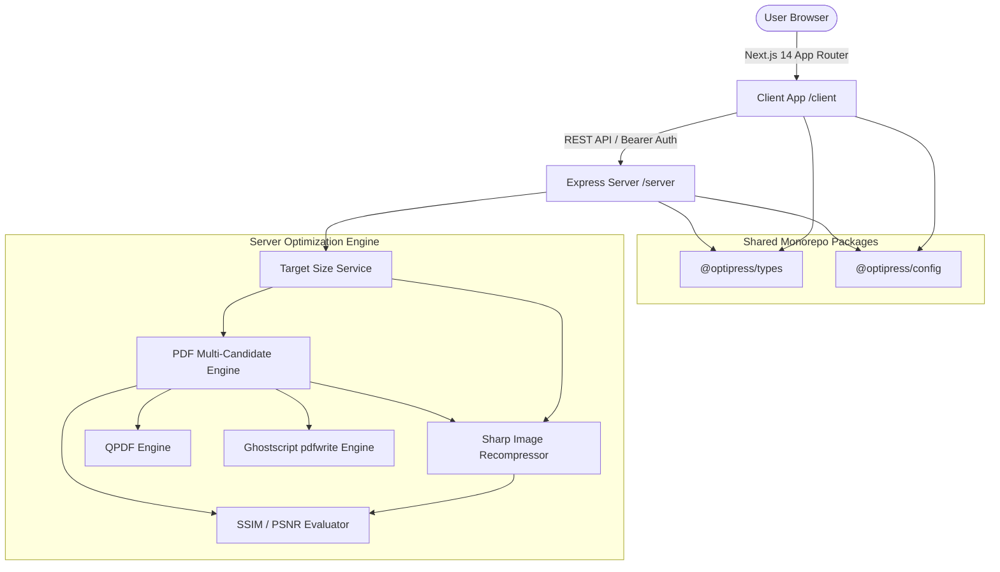
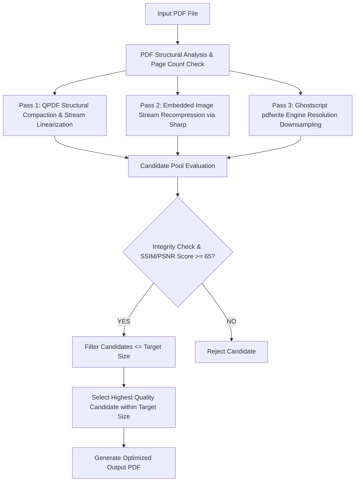

# 🚀 OptiPress — Complete Project Technical Documentation & Blueprint

> **"You choose the target size. We protect visual quality and privacy."**

OptiPress একটি production-grade, privacy-first PDF এবং Image Target-Size Optimization Platform. এই প্রজেক্টের মূল উদ্দেশ্য হলো ইউজারকে একটি নির্দিষ্ট ফাইল সাইজ (যেমন: 99 KB, 100 KB, 200 KB, 1 MB ইত্যাদি) সিলেক্ট বা ইনপুট দেওয়ার সুযোগ দেওয়া এবং সিস্টেম স্বয়ংক্রিয়ভাবে ভিজ্যুয়াল কোয়ালিটি রক্ষা করে ফাইলটিকে ঠিক সেই টার্গেট সাইজে (বা তার নিচে) নামিয়ে আনবে।

---

## 📋 Table of Contents
1. [Project Overview & Key Features](#-project-overview--key-features)
2. [Project Architecture & Monorepo Structure](#-project-architecture--monorepo-structure)
3. [Tech Stack & Languages](#-tech-stack--languages)
   - [Frontend Tech Stack](#frontend-client)
   - [Backend Tech Stack](#backend-server)
   - [Shared Packages & Core Libraries](#shared-packages--tools)
4. [File Size Reduction Algorithms & Mathematical Formulas](#-file-size-reduction-algorithms--mathematical-formulas)
   - [1. Image Target-Size Binary Search Algorithm](#1-image-target-size-binary-search-algorithm)
   - [2. Perceptual Quality Protection Formulas (SSIM & PSNR)](#2-perceptual-quality-protection-formulas-ssim--psnr)
   - [3. PDF Multi-Candidate Optimization Matrix (QPDF + Ghostscript + Sharp)](#3-pdf-multi-candidate-optimization-matrix)
5. [Privacy & Ephemeral Storage Architecture](#-privacy--ephemeral-storage-architecture)
6. [Detailed Directory & Module Breakdown](#-detailed-directory--module-breakdown)
7. [Environment Setup & Running Locally](#-environment-setup--running-locally)
8. [API Endpoints Reference](#-api-endpoints-reference)
9. [Project Manager Summary & Roadmap Status](#-project-manager-summary--roadmap-status)

---

## 💡 Project Overview & Key Features

OptiPress একটি হাই-পারফর্ম্যান্স ফুলস্ট্যাক ওয়েব অ্যাপ্লিকেশন। এটি সাধারণ ইমেজ কম্প্রেসরের মতো কেবল একটি ফিক্সড কোয়ালিটি ড্রপ করে না, বরং এটি **Target-Size Driven Compression Engine** ব্যবহার করে কাজ করে।

- **Precise Target Size Selection**: ইউজার 99 KB থেকে শুরু করে যেকোনো নির্দিষ্ট KB বা MB সাইজ সেট করতে পারে (e.g. Govt Job Forms / Portal Upload Limits)।
- **Privacy-First (Zero Permanent Storage)**: ফাইলগুলো প্রসেস করার পর সার্ভারে সেভ রাখা হয় না। প্রসেসিং এর পরপরই বা ডাউনলোড শেষে সার্ভার থেকে ফাইল ডিলেট হয়ে যায়।
- **Lossless & Lossy Compression Modes**: ছোট ফাইল হলে Lossless structural cleanup করে, আর বড় ফাইল হলে Smart Lossy Optimization প্রয়োগ করে।
- **Smart Quality Guard (SSIM/PSNR Protection)**: সাইজ কমাতে গিয়ে যাতে ছবি বা ডকুমেন্টের টেক্সট ঘোলা/ব্লারি (unreadable) না হয়ে যায়, তার জন্য ম্যাথমেটিক্যাল কোয়ালিটি স্কোর চেক করে প্রসেসিং চালানো হয়।

---

## 🏗️ Project Architecture & Monorepo Structure

OptiPress একটি **TypeScript Monorepo Architecture** অনুসরণ করে তৈরি করা হয়েছে (Powered by **npm workspaces**)। এর ফলে ফ্রন্টএন্ড, ব্যাকএন্ড এবং শেয়ার্ড লাইব্রেরিগুলো একটি সিংগেল রিপোজিটরিতে আলাদা প্যাকেজ হিসেবে ক্লিনলি মেইনটেইন করা যায়।



### Workspace Packages Summary:
- **`client`**: Next.js 14 App Router নির্ভর ইউজার ইন্টারফেস।
- **`server`**: Node.js & Express API সার্ভার যেখানে কোর ফাইল প্রসেসিং এবং কম্প্রেস ইঞ্জিন চলে।
- **`packages/types`**: ফ্রন্টএন্ড এবং ব্যাকএন্ডের মধ্যে শেয়ার করা TypeScript Interface এবং Types।
- **`packages/config`**: ফাইল লিমিট, MIME টাইপস, কোয়ালিটি থ্রেশহোল্ড এবং কনস্ট্যান্ট সেটিংস।

---

## 💻 Tech Stack & Languages

| Domain | Language / Tool | Specification & Role |
| :--- | :--- | :--- |
| **Primary Language** | **TypeScript** | Type-safety, Strict Mode enabled (Frontend & Backend) |
| **Frontend Framework** | **Next.js 14 (App Router)** | React 18, Server & Client Components |
| **Styling & Design System**| **Tailwind CSS + Shadcn UI** | Centralized Semantic HSL Design Tokens, CSS variables |
| **Theme Engine** | **`next-themes`** | System, Light & Dark mode with zero flash |
| **Icons & Validation** | **Lucide React + Zod** | Modern icons + Schema runtime validation |
| **Backend Runtime** | **Node.js (v18+)** | High performance event loop asynchronous I/O |
| **Backend Framework** | **Express.js** | REST API Routing, Middleware, Controller Layer |
| **Security & Utilities** | **Helmet + CORS + Multer** | Request security headers, cross-origin access, multipart upload handling |
| **Auth & Cloud Services** | **Supabase Auth & SSR** | JWT authentication, user session protection |

### Shared Packages & Binary Tools

1. **`sharp` (libvips)**:
   - ইমেজ প্রসেসিংয়ের জন্য ব্যবহৃত অত্যন্ত দ্রুততম লাইব্রেরি।
   - MozJPEG, WebP, PNG Palette Quantization এবং dynamic resolution downscaling হ্যান্ডেল করে।
2. **`QPDF` (CLI Tool)**:
   - PDF এর internal structure linearize করে, cross-reference table garbage collect করে এবং object stream compress করে (Lossless structural compaction)।
3. **`Ghostscript` (`pdfwrite` engine)**:
   - PDF embedded Vector / Raster elements রিকম্প্রেস করে, font subsetting করে এবং DPI resolution downsample করে (`/printer`, `/ebook`, `/screen` profiles)।
4. **`pdf-lib` & `pdfjs-dist`**:
   - PDF parsing, page count extraction, security/encryption validation এবং stream extraction এর জন্য ব্যবহৃত।

---

## 📐 File Size Reduction Algorithms & Mathematical Formulas

OptiPress-এর মূল শক্তি হচ্ছে এর **Smart Target-Size Engine** এবং **Visual Quality Safeguard Algorithm**। ফাইল সাইজ কমানোর জন্য ব্যাকএন্ডে নিম্নোক্ত অ্যালগোরিদম এবং গাণিতিক সূত্রগুলো ব্যবহার করা হয়েছে:

---

### 1. Image Target-Size Binary Search Algorithm

ইমেজের ক্ষেত্রে ইউজার যে Target Size (যেমন: 200 KB) সেট করে দেয়, সেই সাইজে পৌঁছানোর জন্য সিস্টেম একটি **Iterative Binary Search with Dynamic Resolution Scaling Algorithm** চালায়।

#### Step-by-Step Execution:
1. **Initial Boundary Setup**:
   - Quality parameter $Q \in [15, 95]$ (যেখানে 95 হলো সর্বোচ্চ কোয়ালিটি এবং 15 হলো মিনিমাম অ্যাকসেপ্টেবল সীমা)।
2. **Binary Search Iteration**:
   - midpoint Quality calculation:
     $$Q_{\text{mid}} = \left\lfloor \frac{Q_{\text{low}} + Q_{\text{high}}}{2} \right\rfloor$$
3. **Encoding & Evaluation**:
   - $Q_{\text{mid}}$ ব্যবহার করে Sharp দিয়ে প্রার্থী ইমেজ (Candidate Image) ইনকোড করা হয় (MozJPEG / WebP / Palette PNG)।
   - ক্যান্ডিডেট ইমেজের সাইজ $S_{\text{cand}}$ এবং Target Size $S_{\text{target}}$ তুলনা করা হয়।
4. **Resolution Downscaling Fallback**:
   - যদি Quality $Q = 15$ এ নামানোর পরেও ফাইল সাইজ Target এর চেয়ে বড় থাকে, তখন ইমেজের Resolution কমানোর জন্য Step-Down Scale Ladder প্রয়োগ করা হয়:
     $$\text{Scale Factor } \in \{1.0, 0.75, 0.50, 0.35, 0.25\}$$
     $$\text{Target Width} = \max(100, \text{round}(\text{Original Width} \times \text{Scale}))$$
5. **Tolerance & Convergence**:
   - সাইজ যদি Target Size এর 3% সহনশীলতার মধ্যে চলে আসে ($\Delta \le 3\%$) এবং Quality Check পাস করে, তবে Binary Search সাথে সাথে সম্পন্ন হয় (Early Exit)।

---

### 2. Perceptual Quality Protection Formulas (SSIM & PSNR)

সাইজ কমাতে গিয়ে ছবি বা ডকুমেন্ট যেন ঘোলা (Blurry) বা ড্যামেজ না হয়ে যায়, তা নিশ্চিত করতে ব্যাকএন্ডের `quality-evaluator.service.ts` ফাইল দুটি মূল গাণিতিক সূত্র প্রয়োগ করে:

#### A. MSE (Mean Squared Error) Formula:
মূল ছবি $X$ এবং কম্প্রেসড ছবি $Y$ এর পিক্সেল পার্থক্যের বর্গ গড়:
$$\text{MSE} = \frac{1}{N} \sum_{i=1}^{N} (X_i - Y_i)^2$$

#### B. PSNR (Peak Signal-to-Noise Ratio) Formula:
ইমেজের সিগন্যাল ও নয়েজের অনুপাত (ডেসিবেল বা dB এককে):
$$\text{PSNR} = 10 \cdot \log_{10} \left( \frac{255^2}{\text{MSE}} \right)$$
*(মিনিমাম থ্রেশহোল্ড: $\text{PSNR} \ge 30 \text{ dB}$)*

#### C. SSIM (Structural Similarity Index) Formula:
মানুষের চোখ যেভাবে ছবি দেখে (Luminance, Contrast, Structure) তা পরিমাপের সূত্র:
$$\text{SSIM}(X, Y) = \frac{(2\mu_x\mu_y + c_1)(2\sigma_{xy} + c_2)}{(\mu_x^2 + \mu_y^2 + c_1)(\sigma_x^2 + \sigma_y^2 + c_2)}$$
- $\mu_x, \mu_y$: গড় পিক্সেল মান (Luminance)
- $\sigma_x^2, \sigma_y^2$: পিক্সেলের ভ্যারিয়েন্স (Contrast)
- $\sigma_{xy}$: দুই ইমেজের কো-ভ্যারিয়েন্স (Structural correlation)
- $c_1 = 6.5025, c_2 = 58.5225$: স্থিতিশীলতা বজায় রাখার কনস্ট্যান্ট।
*(মিনিমাম থ্রেশহোল্ড: $\text{SSIM} \ge 0.92$)*

#### D. OptiPress Composite Quality Score Equation:
$$\text{Quality Score} = \text{round}\left( 70 \cdot \text{SSIM} + 30 \cdot \min\left(1, \max\left(0, \frac{\text{PSNR} - 15}{30}\right)\right) \right)$$
- **Score $\ge 75$**: Pass (Quality Preserved)
- **Score $< 65$**: Reject Candidate (Prevent blurry output)

---

### 3. PDF Multi-Candidate Optimization Matrix

PDF ফাইলের অভ্যন্তরীণ আর্কিটেকচার জটিল হওয়ায় এটি একটি **Multi-Candidate Generation & Selection Strategy** ব্যবহার করে।



#### The Candidate Generation Matrix:
1. **Pass 1 (Lossless QPDF Structural Pass)**:
   - PDF Streams Unpack & Re-compress, linearize for fast web view, strip unused metadata objects.
2. **Pass 2 (Direct Image Stream Recompression)**:
   - PDF এর ভেতরের ইমেজ স্ট্রিমগুলো এক্সট্র্যাক্ট করে Sharp দিয়ে MozJPEG (Quality 85 $\to$ 55, Dimension scale 1.0 $\to$ 0.6) এ প্রসেস করে পুনরায় PDF এ ইনজেক্ট করা হয়।
3. **Pass 3 (Ghostscript `pdfwrite` Profiles)**:
   - `preserve`: 300 DPI, JPEG Quality 88 (/printer)
   - `academic`: 180 DPI, JPEG Quality 78 (/ebook)
   - `balanced`: 150 DPI, JPEG Quality 70 (/ebook)
   - `strong`: 120 DPI, JPEG Quality 58 (/screen)
   - `extreme`: 90 DPI, JPEG Quality 45 (/screen)
4. **Pass 4 (Ranking & Selection)**:
   - তৈরি হওয়া সকল Valid Candidate থেকে সবচেয়ে কম সাইজ এবং সর্বোচ্চ কোয়ালিটি স্কোরভিত্তিক সেরা ফাইলটি সিলেক্ট করা হয়।

---

## 🔒 Privacy & Ephemeral Storage Architecture

OptiPress একটি **Privacy-First Platform** হিসেবে ডিজাইন করা হয়েছে:
- **No Database File Storage**: ব্যবহারকারীর ফাইল সার্ভারের ডাটাবেজে বা পার্মানেন্ট ক্লাউড স্টোরেজে জমা থাকে না।
- **Isolated Ephemeral Memory Storage**: ফাইল প্রসেসিং সম্পন্ন হওয়ার সাথে সাথেই ডাউনলোড লিংকের জন্য নির্দিষ্ট মেমোরি অ্যালট করা হয় এবং ডাউনলোড সম্পূর্ণ হওয়া মাত্র বা সেশন শেষ হওয়া মাত্রই তা মেমোরি থেকে চিরতরে মুছে ফেলা হয় (Auto-eviction).
- **Security Validation**: ফাইল আপলোডের সময় Magic Bytes, MIME type validation এবং Anti-malware file boundary strict check সম্পন্ন করা হয়।

---

## 📁 Detailed Directory & Module Breakdown

```
optipress/
├── client/                                  # Next.js 14 Frontend Application
│   ├── app/                                 # Next.js App Router (Layouts, Pages, Providers)
│   ├── components/                          # UI Component Library (Buttons, Modals, Nav, Upload Zone)
│   ├── features/
│   │   ├── optimizer/                       # Core Optimizer UI & Services (Image & PDF optimizer services)
│   │   ├── history/                         # Temporary Session History Hook & State
│   │   └── workspace/                       # Active Session File Management Workspace
│   └── styles/                              # Centralized Semantic HSL Design Tokens (globals.css)
├── server/                                  # Node.js + Express API Backend Server
│   ├── src/
│   │   ├── controllers/                     # Request Handlers (Image, PDF, Health controllers)
│   │   ├── middleware/                      # Helmet, CORS, Error Handler, Request Logger
│   │   ├── routes/                          # API Route Definition Layer
│   │   └── services/
│   │       ├── target-size.service.ts        # Image Target Size Binary Search Algorithm
│   │       ├── pdf-optimizer.service.ts     # PDF Multi-candidate Pipeline Engine
│   │       ├── quality-evaluator.service.ts # SSIM / PSNR Perceptual Quality Evaluator
│   │       ├── ghostscript.service.ts       # Ghostscript pdfwrite Integration
│   │       ├── qpdf.service.ts              # QPDF Linearization & Stream Compaction
│   │       ├── image-recompressor.service.ts# Sharp-based Embedded Image Engine
│   │       └── bin-manager.service.ts       # Native CLI Binary Dependency Manager
├── packages/
│   ├── types/                               # Shared TypeScript Definitions (User, FileMetadata, Jobs)
│   └── config/                              # Domain Limits, Presets, Quality Profiles & Rules
├── supabase/                                # Supabase Schema, Auth & Migration Configs
├── package.json                             # Root Monorepo Workspaces Config
└── README.md                                # Master Technical Blueprint Documentation
```

---

## ⚙️ Environment Setup & Running Locally

### Prerequisites:
- **Node.js**: `>= 18.x`
- **npm**: `>= 9.x`
- *(Optional for full PDF Ghostscript pass)*: Ghostscript & QPDF installed on host system PATH.

### 1. Installation:
```bash
# Clone the repository and enter directory
cd optipress

# Install monorepo workspace dependencies
npm install
```

### 2. Environment Configuration:
`.env.example` ফাইল কপি করে `.env` ফাইল তৈরি করুন:
```bash
cp .env.example .env
cp .env.example server/.env
```

### 3. Development Mode:
ক্লায়েন্ট (Next.js - Port 3000) এবং সার্ভার (Express - Port 4000) একসাথে চালু করতে:
```bash
npm run dev
```

অথবা আলাদাভাবে চালু করতে:
```bash
# Client only (http://localhost:3000)
npm run dev:client

# Server only (http://localhost:4000)
npm run dev:server
```

---

## 📡 API Endpoints Reference

| Endpoint | Method | Description |
| :--- | :--- | :--- |
| `GET /health` | `GET` | Backend health check & server status verification |
| `POST /api/images/:fileId/optimize` | `POST` | Image preset optimization mode (Lossless / Smart / Maximum) |
| `POST /api/images/:fileId/target-size` | `POST` | Image target-size binary search optimization |
| `POST /api/pdfs/:fileId/optimize` | `POST` | PDF multi-candidate target size optimization |
| `GET /api/files/:outputFileId/download` | `GET` | Ephemeral processed file stream download |

---

## 📊 Project Manager Summary & Roadmap Status

| Task / Feature | Status | Description |
| :--- | :---: | :--- |
| **Monorepo Architecture** | ✅ Completed | Clean Workspaces (`client`, `server`, `packages/*`) |
| **Frontend UI System** | ✅ Completed | Next.js 14 App Router, Tailwind HSL design tokens, Zero-flash Dark/Light theme |
| **Backend API Engine** | ✅ Completed | Express.js, TypeScript strict mode, Centralized Middleware & Error handling |
| **Image Target-Size Engine** | ✅ Completed | Iterative Binary Search Algorithm with dynamic resolution scaling |
| **PDF Optimization Engine** | ✅ Completed | Multi-candidate strategy using QPDF, Ghostscript & Sharp |
| **SSIM / PSNR Quality Safeguard** | ✅ Completed | Automated mathematical visual quality gate evaluation |
| **Privacy & Storage Model** | ✅ Completed | Zero permanent database storage, Ephemeral temporary eviction |
| **Supabase Auth Integration** | 🔄 In Progress | JWT token authorization and protected routes |
| **Batch Processing & Enterprise** | 📅 Next Phase | Multi-file batch queue processing and enterprise SLA controls |

---

> **Prepared with excellence for OptiPress Engineering & Management Team.**
